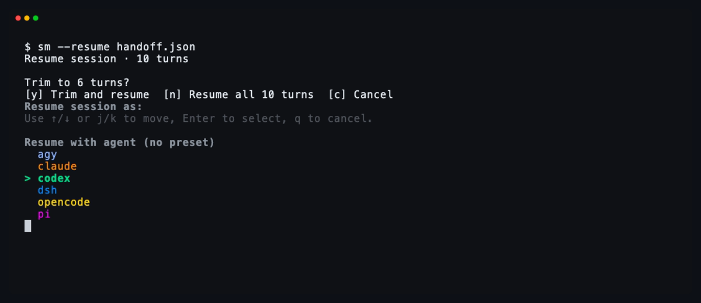
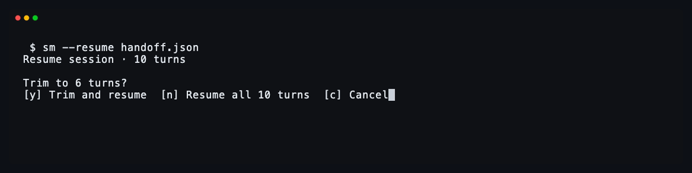
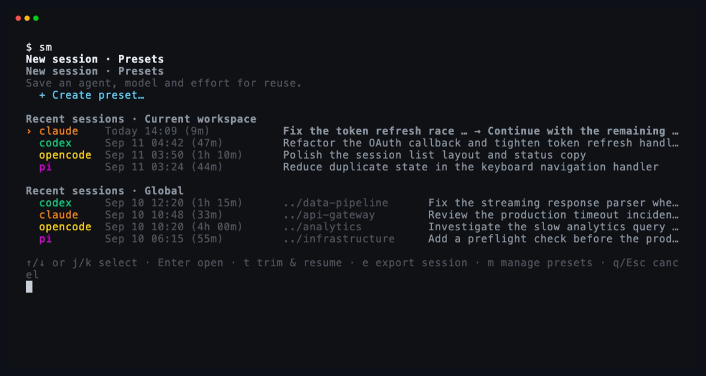
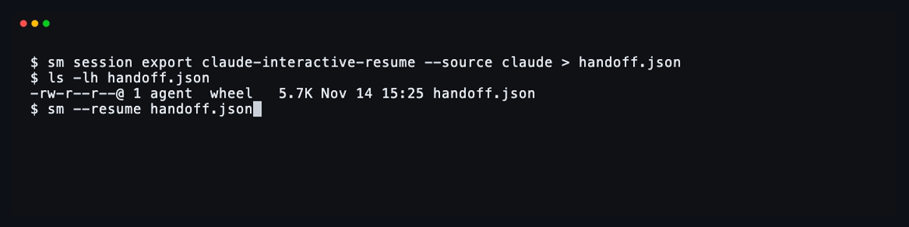

# SessionMan

## Install

macOS / Linux:

```bash
curl -fsSL https://sessionman.dev/install | sh
```

[Windows & other installation options](docs/installation.md)

## What you can do

### **Load** your Claude Code session in Codex when your usage runs out, and keep working.



### **Trim** a bloated session and continue seamlessly.



### **Find** an old session across all your agents and get back to work.



### **Ship** your session to someone else so they can pick up where you left off.



## Supported agents

| Agent | Sessions | Continue in it | Shared skills | Portable hooks |
| --- | --- | --- | --- | --- |
| Antigravity CLI (`agy`) | ✓ | ✓ | Project roots; user install projection | `SessionStart`, `Stop` |
| Claude Code | ✓ | ✓ | Via `.claude/skills` | ✓ |
| Codex CLI | ✓ | ✓ | ✓ | ✓ |
| DeepSeek Harness | — | — | ✓ | — |
| OpenCode | ✓ | Native sessions only | ✓ | — |
| Pi | ✓ | ✓ | ✓ | ✓ |

Shared skills are read from `~/.agents/skills`. OpenCode can resume its own sessions, but cannot resume imported sessions. DeepSeek Harness has no verified session source.

[Agent support details](docs/lifecycle-and-protocol-audit.md)

[Subagents](docs/subagents.md) · [Architecture](docs/architecture.md) · [Contributing](CONTRIBUTING.md) · [Support](SUPPORT.md) · [MIT License](LICENSE)
